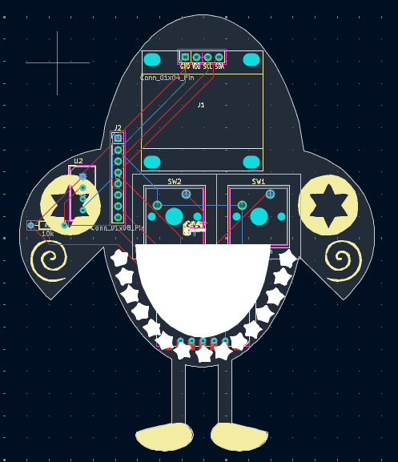
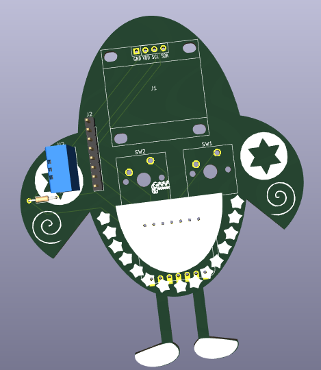
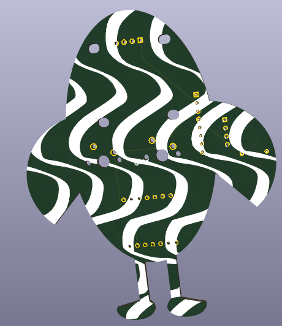
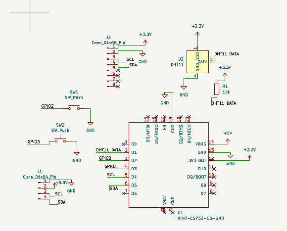

# Starbie

This is a Starbie project that I made following the Starbie toturial. I customised it by making the PCB chicken shaped and adding different designs features to it. I also edited and added my own bitmap art.

I made this project because I have always wanted to learn more about making hardware and I thought embarking upon Half-Life would be a good idea. I have really enjoyed learning how to design a PCB. I especially enjoyed the wiring part of designing it.

## PCB Design and Layout

. 

I made it chicken shaped and added patterns to it to customise it.

3D image:

## Schematics

. 

Created following the Starbie tutorial.

## Firmware

For the firmware I added a custom bitmap that has the beak and eyes for my chicken. I also renamed the menu items to my own ones.

## BOM

- Male and Female Headers	
- Pushbuttons	
- DHT11	
- MPU6050	
- XIAO ESP32-C3	
- 0.96 Inch OLED Display Module	
